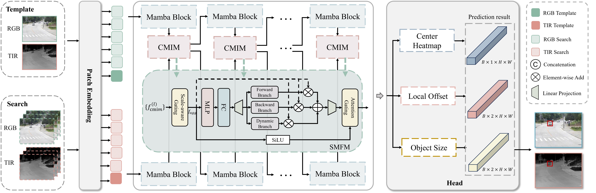
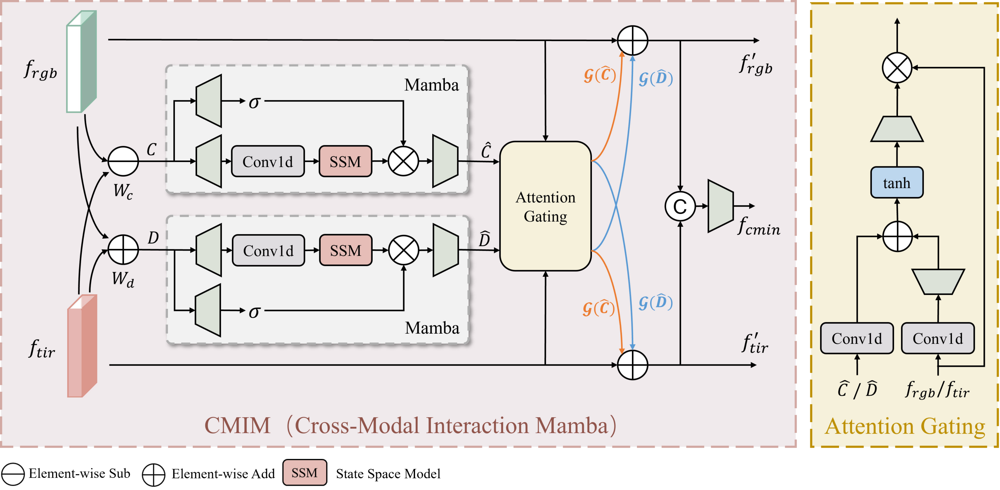
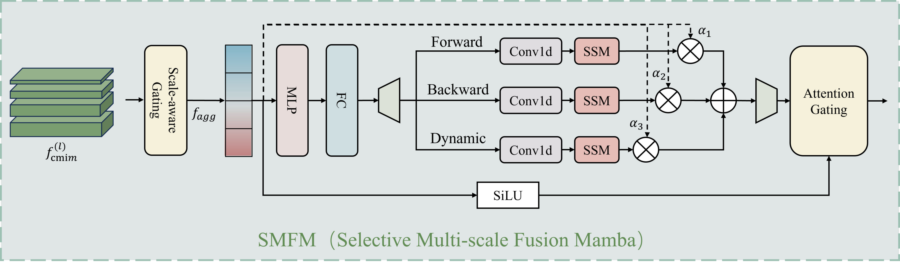

# DCM-Mamba

**Differential Cross-Modal Interaction Mamba with Selective Multi-Scale Fusion for RGBT Tracking**

Official PyTorch implementation of *DCM-Mamba*, a lightweight yet accurate RGBT (RGB + Thermal) visual object tracking framework built on state-space models (Mamba). DCM-Mamba introduces a **Cross-Modal Interaction Mamba (CMIM)** module to align and fuse the two modalities with linear-time cost, and a **Selective Multi-Scale Fusion Module (SMFM)** to adaptively aggregate multi-resolution cues for small and low-resolution targets.



---

## Highlights

- **CMIM (Cross-Modal Interaction Mamba)** — models cross-modal dependencies with a multi-branch state-space scan to obtain well-aligned, discriminative RGB-T representations.
- **SMFM (Selective Multi-Scale Fusion)** — dynamically selects and aggregates multi-scale features, improving robustness to small targets, low resolution and scale variation.
- **Lightweight & fast** — only **29M** parameters while running at **52.9 FPS**, on par with or better than much heavier Transformer-based trackers.
- **Strong results** on four mainstream RGBT benchmarks: GTOT, RGBT210, RGBT234 and LasHeR.

| <sub>Module</sub> | <sub>Preview</sub> |
| :-- | :-- |
| **CMIM** |  |
| **SMFM** |  |

---

## Results

Precision Rate (PR, %) / Success Rate (SR, %). Full comparison (16 trackers) is reported in the paper.

| Method | GTOT (PR/SR) | RGBT234 (PR/SR) | LasHeR (PR/SR) | Params | FPS |
| :-- | :--: | :--: | :--: | :--: | :--: |
| STTrack | 94.7 / 78.4 | 88.8 / 67.1 | 72.6 / 57.9 | 92.8M | 32 |
| AINet | – | 89.2 / 67.3 | 74.2 / 59.1 | – | 37.5 |
| SUTrack | – | 94.6 / 70.8 | 76.9 / 61.9 | 247M | 14.6 |
| MambaVT | 94.1 / 75.3 | 88.9 / 65.8 | 73.0 / 57.9 | 29.9M | 49.7 |
| **DCM-Mamba (Ours)** | **94.1 / 76.2** | **90.2 / 66.2** | **73.3 / 59.1** | **29M** | **52.9** |

---

## Repository Structure

```
DCM_Mamba/
├── assets/                      # Figures used in this README
├── experiments/
│   ├── mambatrack/              # YAML configs (base, finetune, ablations, Small/Middle)
│   └── mambatrack_motion/       # YAML configs for the motion-aware variant
├── lib/
│   ├── config/                  # default configuration
│   ├── models/mambatrack/       # VideoMamba backbone, CMIM/SMFM, tracker, head
│   ├── train/dataset/           # dataset loaders (LasHeR, ...)
│   └── test/                    # tracker wrappers and test parameters
├── RGBT_workspace/
│   ├── test_rgbt_mgpus.py       # evaluation entry point
│   └── results/                 # prediction outputs (git-ignored)
├── tracking/
│   ├── train.py                 # training entry point
│   └── create_default_local_file.py
├── mamba-1p1p1/                 # Mamba selective-scan CUDA kernels
├── xtrain.sh / xtrain_motion.sh # training scripts for Small/Middle variants
└── ytest.sh / ytest_motion.sh   # evaluation scripts
```

---

## Installation

We recommend a Linux environment with an NVIDIA GPU and a CUDA toolkit matching your PyTorch build.

```bash
conda create -n dcm-mamba python=3.10 -y
conda activate dcm-mamba

# 1) Install PyTorch matching your CUDA (example for CUDA 11.8)
pip install torch torchvision --index-url https://download.pytorch.org/whl/cu118

# 2) Install the remaining dependencies
pip install -r requirements.txt

# 3) Build the Mamba CUDA kernels (selective-scan / causal-conv1d)
cd mamba-1p1p1
pip install -e .
cd ..
```

> [NOTE] `mamba-1p1p1` compiles custom CUDA extensions (`csrc/selective_scan`). Make sure `nvcc` (CUDA toolkit) is available and its version matches the PyTorch CUDA version, otherwise the build will fail.

---

## Data Preparation

### Training data

Training uses the **LasHeR** training/validation split. Dataset loaders read their root from `lib/train/admin/local.py`. Generate/refresh it with:

```bash
python tracking/create_default_local_file.py \
    --workspace_dir ./output \
    --data_dir /path/to/datasets \
    --save_dir ./output
```

Then make sure the following entries point to your directories (example):

```python
# lib/train/admin/local.py
self.workspace_dir    = '/path/to/DCM_Mamba/output'
self.pretrained_networks = '/path/to/DCM_Mamba/output/pretrained_networks'
self.lasher_dir       = '/path/to/datasets/lasher/trainingset'
```

Expected LasHeR sequence layout:

```
lasher/
├── trainingset/<seq>/{visible/, infrared/, visible.txt, infrared.txt}
└── testingset/<seq>/{visible/, infrared/, visible.txt, infrared.txt}
```

### Test data

The evaluation entry `RGBT_workspace/test_rgbt_mgpus.py` contains the dataset root paths (`seq_home`). **Edit them to your local directories** before running:

```python
# RGBT_workspace/test_rgbt_mgpus.py  (around the __main__ block)
if dataset_name == 'GTOT':     seq_home = '/path/to/GTOT'
elif dataset_name == 'RGBT210': seq_home = '/path/to/RGBT210'
elif dataset_name == 'RGBT234': seq_home = '/path/to/RGBT234'
elif dataset_name == 'LasHeR':  seq_home = '/path/to/lasher/testingset'
```

Download links:

- GTOT / RGBT210 / RGBT234: <https://github.com/mmic-lcl/Datasets-and-benchmark-code>
- LasHeR: <https://github.com/BUGPLEASEOUT/LasHeR>

---

## Pretrained Backbone Weights

The backbone is initialized from **OSTrack + VideoMamba** pretrained weights. Download them and set `MODEL.PRETRAIN_FILE` in the YAML config accordingly, e.g.:

```yaml
# experiments/mambatrack/mambavt_s256_ep20_lasher.yaml
MODEL:
  PRETRAIN_FILE: "/path/to/pretrained_models/OSTrack_videomambas_ep300.pth.tar"
  BACKBONE:
    TYPE: videomamba_small_576
```

---

## Training

Two variants are provided: **MambaVT-Small** (`s256`) and **MambaVT-Middle** (`m256`). Base training and DFM fine-tuning configs live in `experiments/mambatrack/`.

```bash
# Stage 1: base training (non-LasHeR test split)  -- see xtrain.sh
python tracking/train.py --script mambatrack --config mambavt_s256_ep20 \
    --save_dir ./output --mode multiple --nproc_per_node 2

# Stage 1: base training (for LasHeR evaluation)
python tracking/train.py --script mambatrack --config mambavt_s256_ep20_lasher \
    --save_dir ./output --mode multiple --nproc_per_node 2

# Stage 2: DFM fine-tuning
python tracking/train.py --script mambatrack --config mambavt_s256_dfm_finetune_a1 \
    --save_dir ./output --mode multiple --nproc_per_node 2
```

- Use `--mode single` for a single GPU.
- Checkpoints, logs and TensorBoard files are written under `--save_dir`.

## Evaluation

```bash
# MambaVT-Small -- see ytest.sh
python ./RGBT_workspace/test_rgbt_mgpus.py --script_name mambatrack \
    --yaml_name mambavt_s256_ep20 --dataset_name GTOT     --epoch 20
python ./RGBT_workspace/test_rgbt_mgpus.py --script_name mambatrack \
    --yaml_name mambavt_s256_ep20 --dataset_name RGBT234  --epoch 20
python ./RGBT_workspace/test_rgbt_mgpus.py --script_name mambatrack \
    --yaml_name mambavt_s256_ep20_lasher --dataset_name LasHeR --epoch 20
```

Predictions are saved to `RGBT_workspace/results/<dataset>/<yaml_name>_testep<epoch>/<seq>.txt`.
`--epoch` must match the checkpoint epoch you want to evaluate.

---


## Acknowledgements

This code is heavily built upon the excellent open-source projects
**MambaVT**, [OSTrack](https://github.com/botaoye/OSTrack),
[VideoMamba](https://github.com/OpenGVLab/VideoMamba) and
[mamba](https://github.com/state-spaces/mamba). We thank the authors for releasing their code, and
the GTOT, RGBT210, RGBT234 and LasHeR teams for the benchmarks.

## Contact

Minshu Li — `LMS2815653420@163.com`

For questions about the code, please open an issue or contact me by email.
